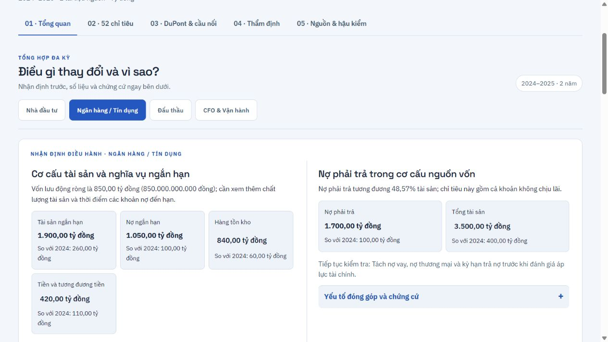
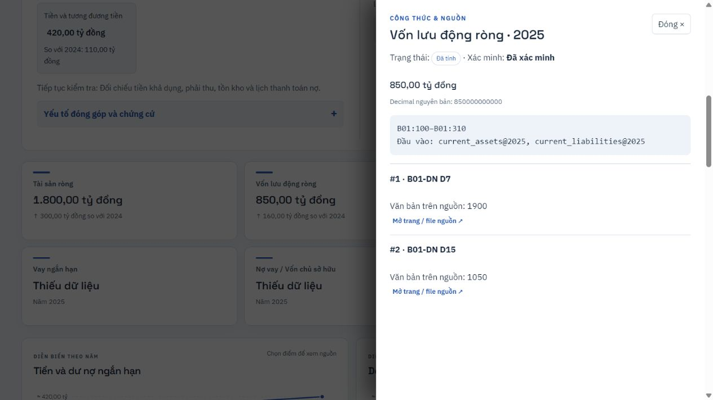

# Financial Statement Evidence API

**Từ báo cáo tài chính gốc đến nhận định có thể kiểm tra.** Đây là dự án cá nhân xây một bàn phân tích BCTC tiếng Việt: nạp Excel/PDF, chuẩn hóa số liệu theo công ty–kỳ–đơn vị, tính và so sánh chỉ tiêu, phát hiện điểm cần rà soát, rồi cho người xem mở lại công thức và vị trí nguồn của từng con số.

*Góc nhìn Ngân hàng / Tín dụng trên bộ dữ liệu minh họa 2024–2025. Dashboard đặt vốn lưu động, cơ cấu tài sản và nghĩa vụ ngắn hạn cạnh nhau để người xem nhận ra câu hỏi cần kiểm tra tiếp; số liệu trong ảnh là dữ liệu mẫu, không đại diện cho doanh nghiệp thật.*

### Một tình huống phân tích trong bộ dữ liệu minh họa

Workbook FY2025 tổng hợp có **lợi nhuận sau thuế +65 triệu đồng** nhưng **dòng tiền kinh doanh −80 triệu đồng**. Hệ thống không chỉ in hai số: nó tạo tín hiệu *lợi nhuận dương trong khi tiền từ hoạt động kinh doanh âm* để người phân tích kiểm tra. Cùng báo cáo đó, phải thu khách hàng tăng khoảng **116,67%**, nhanh hơn doanh thu **30%**; đây là tín hiệu rà soát thứ hai. Tài sản ngắn hạn **500 triệu** và nợ ngắn hạn **300 triệu** cho vốn lưu động ròng **200 triệu đồng**.

Những con số trên là **fixture tự tạo**, không phải kết luận về doanh nghiệp thật. Tín hiệu chỉ nêu chênh lệch cần xem tiếp; nó không suy ra gian lận, khả năng trả nợ hay khuyến nghị đầu tư. [Xem dữ liệu và phép tính của tình huống](docs/M4_HEALTH_REVIEW.md).

## Người xem làm được gì?

1. **Nạp và chọn đúng báo cáo.** Excel được đọc cùng ô nguồn; PDF được trích xuất theo trang và đưa giá trị chưa xác nhận vào hàng đợi hậu kiểm. Bộ lọc giữ riêng công ty, năm tài chính, báo cáo riêng/hợp nhất và đơn vị tiền.
2. **Đọc kết quả nhiều kỳ.** Giao diện tổ chức tổng quan, ma trận 52 chỉ tiêu, phân rã ROE DuPont và bốn cầu nối biến động: lợi nhuận, dòng tiền kinh doanh, nguồn tài trợ, tiền. Chỉ tiêu thiếu đầu vào hoặc chỉ là proxy được đánh trạng thái riêng thay vì hiển thị như một giá trị chắc chắn.
3. **Kiểm tra đường đi của một nhận định.** Bấm vào một chỉ tiêu để xem giá trị, công thức, kỳ, đơn vị, mức xác minh và ô Excel hoặc trang PDF liên quan. Các phép tính dùng `Decimal` và giữ danh sách dữ kiện đầu vào.
4. **Rà soát trước khi kết luận.** Hệ thống nêu xung đột/thiếu chứng cứ và có thể từ chối câu trả lời số khi đầu vào chưa đủ tin cậy. Nhánh đối chiếu tiêu chí tài chính nhà thầu dùng ngưỡng do người dùng cung cấp, trả từng tiêu chí kèm bằng chứng; nó không tự ra quyết định chọn nhà thầu.

## Xem phân tích, rồi lần về chứng cứ

*Mở một chỉ tiêu để xem giá trị, công thức và các ô Excel đã đóng góp vào phép tính. Ví dụ trong ảnh là dữ liệu tổng hợp; “đã xác minh” mô tả kiểm tra trong prototype, không phải xác nhận độc lập báo cáo của một doanh nghiệp.*

## Vì sao làm dự án này?

Một dashboard đẹp vẫn khó dùng cho phân tích nếu không biết số đến từ tài liệu, kỳ và đơn vị nào. Dự án nối **nạp báo cáo → tính toán → tín hiệu rà soát → bằng chứng nguồn** trong cùng luồng, để người dùng có thể kiểm tra và phản biện kết quả.

## Luồng xử lý

~~~mermaid
flowchart LR
  F[TT200-style XLSX or PDF] --> I[Ingestion and normalization]
  I --> V[Versioned facts with source locators]
  V --> Q[Question routing]
  Q --> C[Decimal-based calculations]
  C --> E[Evidence and consistency checks]
  E --> A[Answer, finding, or refusal]
  H[Human review] --> V
~~~

- XLSX facts retain source-cell references and document hashes.
- PDF facts keep page and region provenance; extracted values remain pending until reviewed.
- The analysis layer uses Decimal and explicit period, unit, scope, and conflict policies.
- The API can refuse when evidence is missing or a calculation cannot be supported.

## Example scope

The project implements core financial indicators, accounting bridges, DuPont analysis, and review signals for comparative financial analysis. The formula checker is intentionally limited to supported patterns such as SUM(A1:A5) and simple cell addition/subtraction; unsupported spreadsheet formulas remain unverified.

## Synthetic regression snapshot

The holdout_v1 set contains invented FY2025 workbooks and 60 diagnostic questions. The reported 60/60 result is on a known regression set authored with knowledge of the implementation, not on a fresh blind benchmark. The flat-text comparison also lacks cell-location support, so evidence-cell results are not an apples-to-apples capability test. See docs/error_analysis.md.

A small real-document pilot is described in docs/M4B_REAL_PILOT.md: two public statements, 56/60 labeled values extracted, and 22/22 arithmetic checks. This is exploratory development evidence, not independent validation or a production accuracy claim.

## Run locally

    python -m pip install -r requirements-m2.txt
    uvicorn app.api.main:app --reload

Open http://127.0.0.1:8000/analysis for the analysis workbench and /audit for PDF review. API contracts and example requests are in docs/M2_API.md.

You can upload your own XLSX or PDF from the workbench. The health-review example and its synthetic figures are described in:

- [Health-review workflow](docs/M4_HEALTH_REVIEW.md)
- [Tender criteria prototype](docs/M5_TENDER_REVIEW.md)

The focused UI formatting check currently available in this public checkout is:

    python -m pytest tests/test_ui_presentation.py -q

The broader historical test suite is **not a clean-checkout pass yet**: some tests expect local source manifests, benchmark files, and script modules that are not included in this public repository. I ran the full suite while preparing this portfolio; collection stopped on those missing files before the affected tests could execute.

## Structure

- app/adapters/ — spreadsheet and PDF readers.
- app/models/ — financial facts and request/response contracts.
- app/services/ — normalization, evidence checks, routing, calculations, and review services.
- app/api/ — FastAPI routes.
- app/web/ — browser workbench.
- benchmarks/holdout_v1/ — synthetic benchmark generation.
- tests/ — API, review workflow, and regression checks.

## Limits

This is a local research prototype. It has no authentication or multi-user authorization. Synthetic benchmark results do not establish extraction accuracy on arbitrary filings. Review signals support investigation; they do not determine credit, tender, fraud, or investment decisions.
